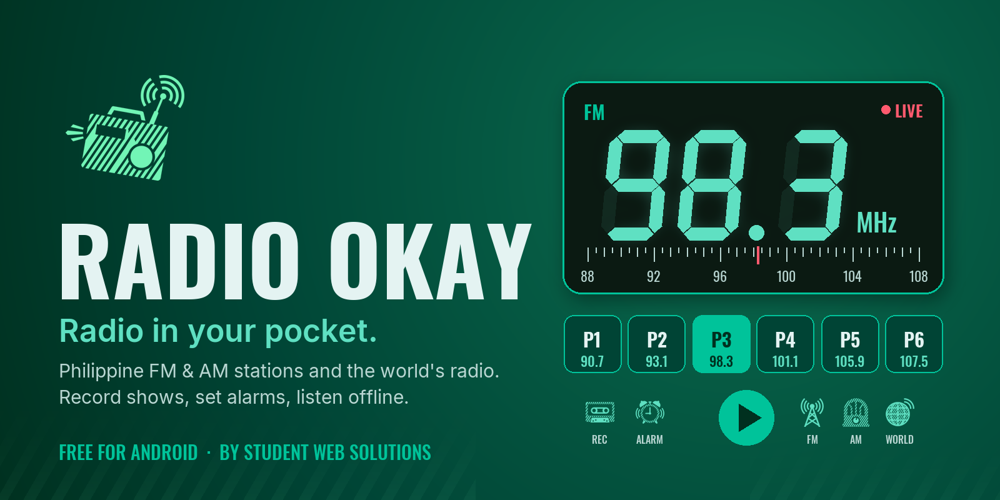
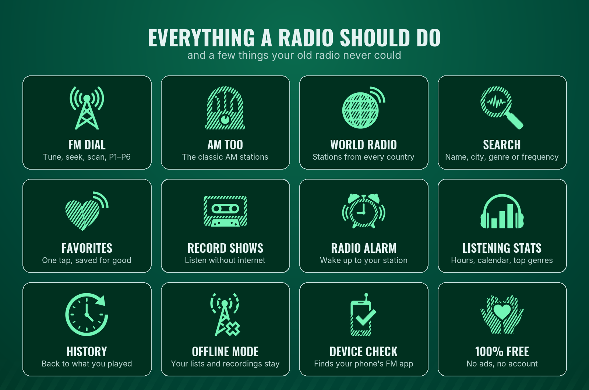
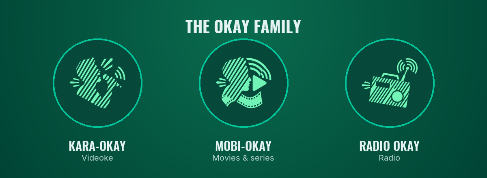

  

  
  
  

<h3 align="center">Philippine FM & AM radio and the world's stations, in one simple app.</h3>

  Big LED numbers, a dial you can slide, and six preset buttons, just like the radio at home. 
  Record your favourite show, wake up to your station, and listen to your recordings offline.

---

## ⬇️ Download (free)

| Where will you listen? | Get it here |
|---|---|
| 📱 **Android phone or tablet** | [**Radio Okay 1.0.0**](https://github.com/PrinceSanguan/Radio-Okay/releases/latest): tap `RadioOkay-1.0.0.apk` under **Assets** |

> **Tagalog:** Buksan ang link sa **Chrome** (hindi sa loob ng Facebook o Messenger), i-tap ang `RadioOkay-1.0.0.apk`, tapos **Install**. Kapag sinabi ng phone na bawal, i-on ang **"Allow from this source"** at i-tap ulit ang Install. Libre ito, walang bayad, walang account.

Already installed? You don't need to come back here. Radio Okay tells you when a new version is out and updates itself inside the app.

## Why Radio Okay

- **As easy as a real radio.** Slide the dial, tap ◀◀ ▶▶ to jump to the next station, or press P1 to P6. If you've used a radio, you already know how to use it.
- **The Philippines, ready to play.** About 700 Philippine stations, sorted into FM, AM and Online, with a filter for Metro Manila, Cebu, Davao, Baguio and more.
- **And the rest of the world.** Thousands of stations from every country, by genre or by name.
- **Keep the show.** Record with one tap, or schedule a recording for later, even with the app closed. Recordings play without internet.
- **Yours only.** No account, no ads, no tracking. Everything stays on your phone.

  

## Features

| | |
|---|---|
| 📻 **FM & AM dial** | A big LED frequency, a sliding dial (digital or analog look), seek ◀◀ ▶▶, **Auto Scan** that finds the live stations, presets **P1–P6** for FM and AM, and a keypad: type `983` for 98.3. |
| 🌏 **Browse** | Philippines by FM, AM, Online and All; the world by country, genre or name. Popular, trending, **For you** picks and **Recently played**. |
| 🎵 **Now playing** | The song title and artist when the station sends them, also on the lock screen. Signal bars, stream quality, and a backup stream when one goes down. |
| ⭐ **Favorites & library** | Favorites that work offline, categories, your own names and logos, notes, history, and four layouts (list, compact, grid, card). Import and export your stations (JSON, M3U, PLS). |
| ⏺️ **Recording** | One-tap REC, scheduled recordings, a time limit, rename, share, **Save to Music**, and automatic clean-up when space runs low. |
| 🎚️ **Sound** | A 10-band equalizer with 10 presets (Rock, Pop, Jazz, Bass Boost, Vocal and more), bass, treble, balance, mono, stereo widen, volume leveling, a visualizer, and your choice of speaker, headphones or Bluetooth. |
| ⏰ **Alarm & sleep timer** | Wake up to your station (it falls back to an alarm tone if the stream fails), and a sleep timer that fades out. |
| 📊 **Listening stats** | Hours per station, a listening calendar and your top genres. |
| 📱 **On your phone** | Notification and lock-screen controls, headset and Bluetooth buttons, a home-screen widget, a Quick Settings tile and Android Auto. |
| 🎨 **Your look** | Five colours (Green, Ocean blue, Purple night, Rose, Soft dark), dark, AMOLED black or light, and your own background picture. |
| 📶 **Data saver** | Shows how many MB an hour a station uses, warns you on mobile data, and has a Wi-Fi only mode. |
| 🔍 **Device Check** | Tells you if your phone has a built-in FM radio app, and opens it. |
| 🔄 **Updates inside the app** | A new version shows up by itself: tap **Update now**. Your favorites, recordings and settings stay. |

### Why it uses the internet

Android doesn't let ordinary apps use a phone's FM chip: only the phone maker's own FM app can. So Radio Okay plays each station's **official live stream**, which works on every phone, with or without an FM chip, and with no earphones needed as an antenna. When you tune to 98.3, it plays the station on 98.3. Your favorites, recordings and settings still work offline.

## Will it run on my device?

| | |
|---|---|
| ✅ **Android 8.0 or newer** | Phones and tablets |
| 🌐 **Internet** | Wi-Fi or mobile data to listen (recordings play offline) |
| 💾 **Space** | About 5 MB for the app, plus your recordings |

## Privacy

No account, no ads, no analytics. History, favorites and recordings never leave your phone, and you can pause or clear your history any time. **Privacy & Permissions** in the app shows every permission and why it's there.

| Permission | Why |
|---|---|
| Internet, network state | Play the stations; know when you're on Wi-Fi or mobile data |
| Foreground service, wake lock | Keep playing and recording with the screen off |
| Notifications | Player controls, recordings and alarms |
| Exact alarms, start at boot | Wake you up and start scheduled recordings on time, even after a restart |
| Install updates | Install a new Radio Okay version when you tap **Update now** |

No location, microphone, contacts or storage permission.

  

## The Okay family

Radio Okay is the sister of **[Kara-okay](https://github.com/PrinceSanguan/KARA-OKAY)**, the Filipino videoke on your phone, TV and PC, and **Mobi-okay**, for movies and series. Same look, same simple way of doing things.

## Support Radio Okay

Radio Okay is free. If it keeps you company, you can give back with **GCash or any InstaPay app**: in the app, tap **♥ DONATE · GCASH** on the Dial screen, or **More → Support Radio Okay**. Any amount helps, and nothing changes if you don't.

**Want your own version?** Your station's name, logo, colours or a new feature: [message us on Facebook](https://www.facebook.com/Grandmaster1997/).

## Made by Student Web Solutions

<table>
  <tr>
    <td></td>
    <td>
      <b>Student Web Solutions</b> · Philippines 
      Apps, websites and complete capstone and thesis systems for Filipino students: built, deployed and ready for defense.
    </td>
  </tr>
</table>

  
  
  

## Notices

Radio Okay is free to download and use. Its source code is not public.

It is built with open-source libraries, used unmodified: Jetpack Compose, AndroidX and Media3 (ExoPlayer), OkHttp, Coil and kotlinx, under the Apache License 2.0, and the Oswald and Inter fonts, under the SIL Open Font License 1.1.

Station names, logos and streams belong to their broadcasters. Recordings are for personal use only.

   
  Made in the Philippines 🇵🇭 by <a href="https://www.facebook.com/people/StudentwebSolution/61560390520092/">Student Web Solutions</a> · © 2026 PES

